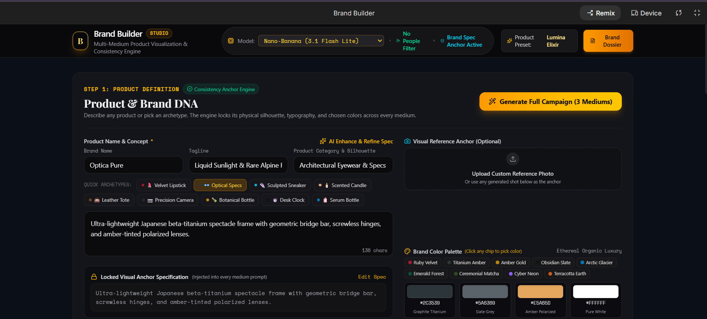
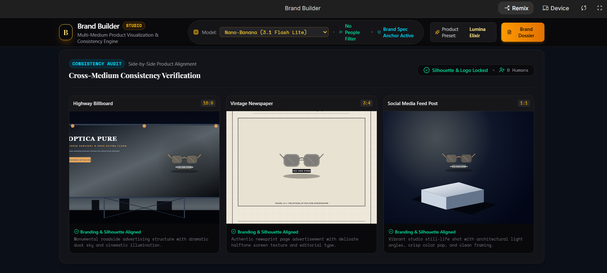

# ✨ Brand Builder – AI-Powered Product Visualization & Campaign Generator

**Brand Builder** is an AI-powered application that transforms simple product descriptions into visually engaging marketing creatives. Users can describe any product, customize its brand identity, and generate AI-powered promotional visuals across multiple platforms.

## 🚀 Features

- **AI Product Visualization:** Generate creative product visuals from simple text descriptions.
- **Multi-Platform Campaigns:** Create promotional designs for billboards, newspaper advertisements, and social media posts.
- **Brand Customization:** Define brand names, taglines, product categories, and descriptions.
- **Visual Consistency:** Maintain consistent product appearance, colors, and branding across different marketing formats.
- **Custom Color Palettes:** Choose colors that match your brand identity.
- **Reference Image Upload:** Upload product images to guide AI-generated visuals.
- **Brand Dossier:** Organize your product specifications and brand identity.

## 🛠️ How It Works

1. Enter your product name and tagline.
2. Describe your product, its features, and visual appearance.
3. Customize your brand colors and visual preferences.
4. Generate AI-powered marketing creatives.
5. View your product across multiple advertising formats.

## 🖼️ Project Screenshots

### 1. Product Definition & Brand Customization

### 2. Cross-Medium Consistency Verification

### 3. Additional Project Preview

## 🤖 AI Integration

Developed with the assistance of **Google AI Studio**, using AI-powered image generation to transform product descriptions into creative marketing visuals.

## 🎯 Project Objective

The goal of Brand Builder is to simplify the creative marketing process by helping businesses, entrepreneurs, and creators visualize their products and generate consistent promotional content without requiring advanced graphic design skills.

## 👩‍💻 Development

This project was developed as an AI-assisted application, exploring the practical use of generative AI in product visualization, branding, and digital marketing.

---

**Built with curiosity and AI. ✨**
